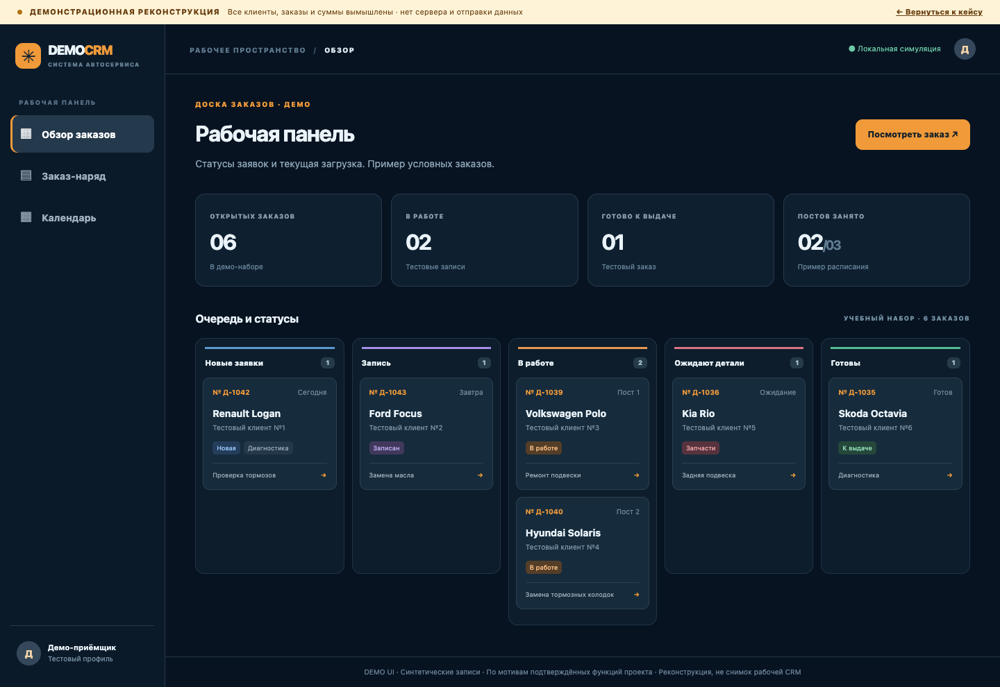

# Сайт и CRM автосервиса — демонстрация проекта

Рабочий проект объединяет публичный сайт автосервиса с внутренними процессами: запись клиентов, заказ-наряды, статусы, календарь, персонал и расчёты. Реальная система используется автосервисом; владелец разрешил демонстрацию проекта.

**Интерактивный пример:** скачайте репозиторий и откройте файл `demo/index.html` в браузере. Это самостоятельная реконструкция доски заказов, карточки заказ-наряда и календаря. Все записи, сотрудники, автомобили, номера и суммы вымышлены. Пример работает без базы, авторизации, серверных запросов и уведомлений.

*Изображение из автономной реконструкции, не из действующей CRM.*

## Что здесь есть

- `demo/` — самостоятельная интерактивная реконструкция интерфейса CRM.
- `screenshots/` — три кадра этой реконструкции, **не скриншоты действующей CRM**.
- `source-excerpts/` — отдельные реальные файлы рабочего проекта: компоненты календаря и карточки услуги, валидация и ограничение частоты запросов. Это выборочные фрагменты архитектуры, а не полный проект и не самостоятельная сборка Next.js.

## Мой вклад

Сбор требований по рабочим процессам автосервиса, архитектура приложения, разработка с использованием ИИ, тестирование, диагностика и сопровождение.

## Устройство основного проекта

Публичный сайт принимает заявки; серверная часть обрабатывает и проверяет данные, а внутренняя система объединяет заказы, календарь, сотрудников и учёт расчётов. Пример демонстрирует пользовательские сценарии, сохраняя данные полностью внутри браузера.

В файле [`CalendarBoard.tsx`](source-excerpts/components/CalendarBoard.tsx) показан компонент календаря из рабочего проекта, а в [`schema.ts`](source-excerpts/lib/schema.ts) — проверка полей формы. [`rate-limit.ts`](source-excerpts/lib/rate-limit.ts) демонстрирует ограничение частоты запросов с хранением состояния в памяти одного процесса. Для нескольких экземпляров сервера такой подход потребует общего хранилища; здесь он представлен как конкретное решение и его ограничение.

## Границы демонстрации

В публичный материал намеренно не перенесены база клиентов, заказы, финансы, настройки сервера, интеграционные ключи и Git-история исходного проекта. Реальную CRM не следует открывать посторонним. Код из `source-excerpts/` иллюстрирует решения рабочего приложения, но для самостоятельного запуска зависит от закрытых модулей.

Для локального просмотра достаточно открыть `demo/index.html` в браузере. Публичная ссылка на браузерную версию будет добавлена после размещения демонстрации на статическом хостинге.
